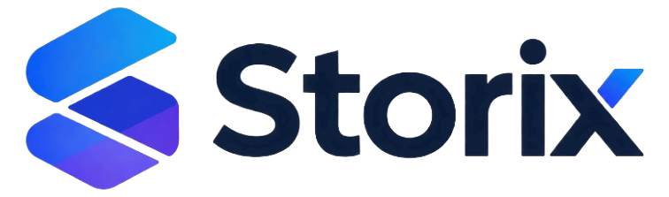

<p align="center">
  <picture>
    <source media="(prefers-color-scheme: dark)" srcset="docs/images/storix-logo-white.png">
    
  </picture>
</p>

# Storix Runtime Image

<p align="center">
  <a href="#test-status--container-hardening-scorecard"></a>
  <a href="#test-status--container-hardening-scorecard"></a>
  <a href="#test-status--container-hardening-scorecard"></a>
  <a href="#test-status--container-hardening-scorecard"></a>
  <a href="#test-status--container-hardening-scorecard"></a>
  <a href="#test-status--container-hardening-scorecard"></a>
</p>

Production-hardened enterprise container runtime with pre-baked AI assistant and Amazon Bedrock integration for AWS ECS Fargate.

---

## Test Status & Container Hardening Scorecard

| Test Category | Suite / File | Tests | Key Invariants Verified | Status |
|---|---|---|---|---|
| **Adversarial Resilience** | `test_adversarial_challenger.py` | **15** | Database outage survival, non-zero exit code error trapping (`set -euo pipefail`), pre-baked SHA256 checksums |  |
| **Dynamic Resolution & EFS Drift** | `test_adversarial_challenger_m1_gen2.py` | **15** | Host-header wildcard rejection (`*` strictly purged), trusted_proxies CIDR parsing, EFS modular sync (`cmp -s`), tenant `config.php` protection |  |
| **Architecture & Configuration** | `test_runtime.py` | **24** | Multi-stage builder, pre-baked AI apps, OPcache tuning (512MB / 20k files), S3 vault binding, Redis locking |  |
| **Runtime Features** | `test_runtime_features.py` | **7** | Fast boot healthcheck (< 15s), Redis transactional locking, PHP resource boundaries, loopback preservation |  |
| **Security Audits** | Trivy + Hadolint + ShellCheck | **All** | **0 CVEs**, **0 Misconfigurations** (Zero tolerance gate), strict shell script syntax checking |  |
| **WebDAV Stress Benchmark** | `tests/load/k6_webdav_stress.js` | K6 Suite | High-concurrency WebDAV upload, download, PROPFIND, and delete validation |  |
| **Total Runtime Tests** | **Full Automated Suite** | **61 / 61 (100%)** | **Enterprise Container Parity Verified** |  |

---

## 1. Overview & Golden Image Baking Strategy

In a **Zero-NAT** cloud environment, containers cannot freely download external dependencies or apps from the internet at runtime without internet gateways or NAT. Downloading apps at container boot also significantly degrades container startup and scaling times.

To solve this, this repository implements a **Golden Image Baking** strategy:
* **Pre-Baked AI Apps:** The Dockerfile downloads and installs Nextcloud Assistant (`v4.0.0`) and OpenAI / Bedrock Integration (`v5.0.0`) into `/var/www/html/custom_apps/` and `/usr/src/nextcloud/custom_apps/` during image build time.
* **Production Hardened Config:** Pre-seeded configuration [`config/nextcloud.config.php`](config/nextcloud.config.php) configures reverse proxy headers for ALB, strict transport security (HSTS), APCu local memcache, and S3 Primary ObjectStore bindings.
* **Smart Entrypoint Hook:** The hook script [`hooks/01-setup-ai.sh`](hooks/01-setup-ai.sh) verifies `occ status` (`installed: true`) before activating apps and connecting them to the LiteLLM Bedrock Bridge sidecar (`http://127.0.0.1:4000/v1`).

---

## 2. Directory Structure

```
.
├── Dockerfile                  # Multi-layer Dockerfile extending nextcloud:30.0.17-apache
├── config/
│   ├── nextcloud.config.php    # Hardened system config (ALB proxy, APCu, HSTS, S3 Vault)
│   └── ai.config.php           # AI apps overwrite allowlist
├── hooks/
│   └── 01-setup-ai.sh          # Container initialization hook for AI apps & LiteLLM linking
├── .github/
│   └── workflows/
├── .devsecops/
│   ├── .pre-commit-config.yaml # DevSecOps master hook suite
│   ├── .hadolint.yaml          # Dockerfile linting configuration
│   ├── .trivy.yaml             # Trivy security scanning configuration
│   └── .trivyignore            # Trivy vulnerability suppressions
└── Dockerfile                  # Multi-layer Dockerfile extending nextcloud:30.0.17-apache
```

---

## 3. Automated CI/CD Image Build (GitHub Actions)

Container builds are automated via [`.github/workflows/docker.yml`](.github/workflows/docker.yml):
* **Triggers:** Push to `main`, git tags (`v*`), or on-demand via `workflow_dispatch`.
* **Builder:** Docker Buildx targeting `linux/amd64` (AWS Fargate compatible).
* **ECR Destination:** Amazon ECR repository `filestore-runtime` with automated vulnerability scanning on push.
* **Authentication:** AWS IAM OpenID Connect (OIDC) federation without static credentials.

---

## 4. Automated Testing

Run the automated test suite locally:

```bash
# Run all automated static, configuration, and simulation tests
./tests/run_tests.sh

# Or run tests including full Docker build verification
./tests/run_tests.sh --docker
```

The automated test suite verifies:
* **Dockerfile Invariants:** Multi-stage build separation, pre-baked AI applications, labels, hook lifecycle registrations, and container healthcheck.
* **PHP Hardening & Config:** Reverse proxy HTTPS enforcement, RFC 1918 proxy CIDRs, APCu local memcache, HSTS, and S3 Primary ObjectStore parameters.
* **OPcache Production Tuning:** Memory limits, string buffers, and pre-compiled comment preservation.
* **Entrypoint Hook Simulation:** Sandboxed mock execution verifying `.tenant_initialized` persistence flag logic, `FORCE_REINIT`, AI app enablement, and Redis locking.
* **Security & Vulnerability Auditing (Trivy):** Automated Aqua Security Trivy scanning checking for CVE vulnerabilities, misconfigurations, and secret leaks.

---

## 5. Local Build & Run

To build and run the image locally:

```bash
docker build -t filestore-runtime:latest .

# Run locally with PostgreSQL container or mock database
docker run -d -p 8080:80 \
  -e POSTGRES_HOST=host.docker.internal \
  -e POSTGRES_DB=nextcloud \
  -e POSTGRES_USER=nextcloud \
  -e POSTGRES_PASSWORD=testpassword \
  filestore-runtime:latest
```

---

## License

Licensed under the [GNU Affero General Public License v3.0 (AGPL-3.0)](LICENSE) to comply with upstream Nextcloud licensing requirements.

